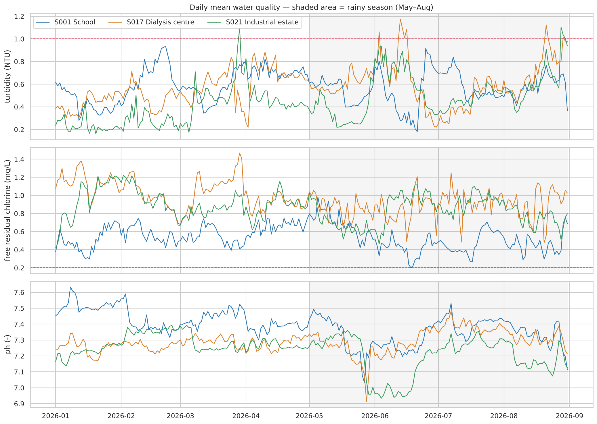
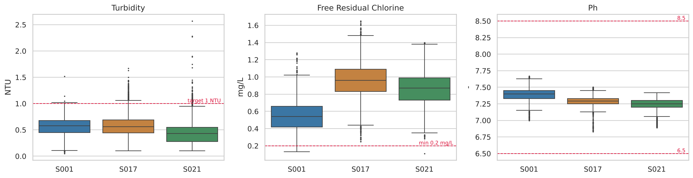
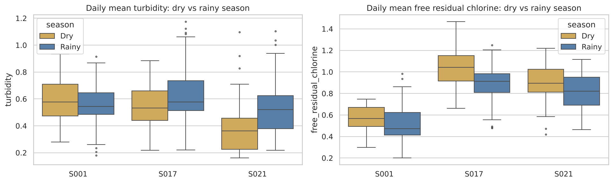
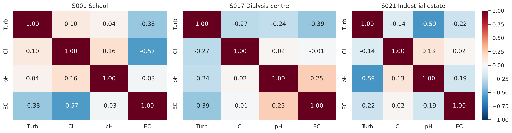
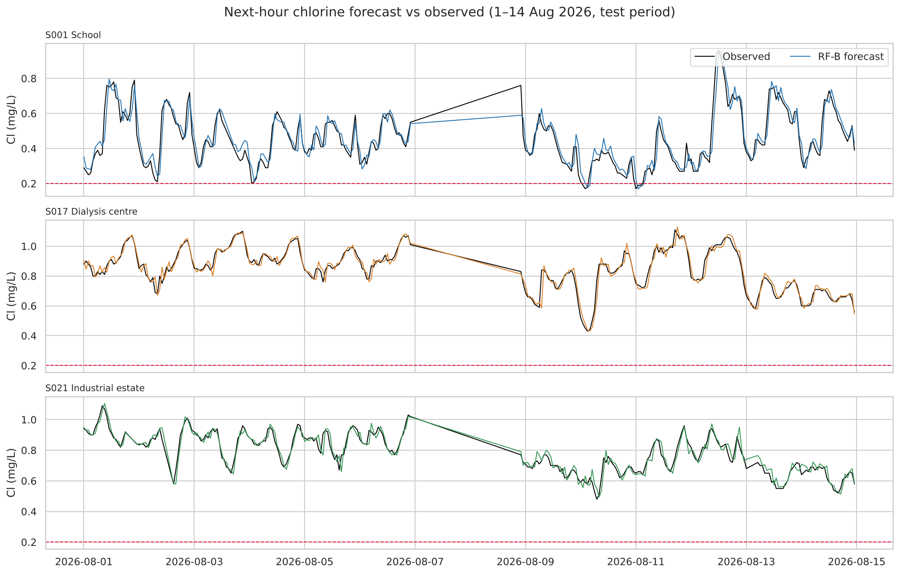

# Tap Water Quality Monitoring in the MWA Distribution Network (Jan–Aug 2026)

**Team**

| Name | Student ID |
|---|---|
| Tharnut Mongkolchaipratheep | 6631007321 |
| Phattajaree Songsom | 6631020421 |

---

## 1. Project Title

**Tap Water Quality Monitoring in the MWA Distribution Network: chlorine, turbidity and pH at three sites, with a next-hour chlorine forecast**

## 2. Environmental Problem

Free residual chlorine is the last barrier against microbial regrowth in a drinking-water network. The Metropolitan Waterworks Authority (MWA) keeps it at **≥ 0.2 mg/L**. Turbidity must stay **≤ 5 NTU** and pH within **6.5–8.5** under the Thai Department of Health drinking-water criteria. Chlorine decays as water travels through the pipes, and rainy-season raw water carries more suspended solids. Water that leaves the treatment plant safe may therefore not reach every tap equally safe, and sensitive users such as hospitals and dialysis centres feel that most.

**Research questions**
1. Does tap water at the selected stations meet the chlorine, turbidity and pH criteria?
2. How do the stations differ, and does the rainy season change turbidity and chlorine?
3. How are the parameters related to each other?
4. Can a basic machine-learning model forecast next-hour chlorine for early warning?

## 3. Dataset Source

| Item | Detail |
|---|---|
| Dataset | *Online Tap Water Quality* (คุณภาพน้ำประปาออนไลน์), resource *Tap Water Quality from Online Water Quality Meters, 2569* (`water_quality_online_2569`) |
| Publisher | Metropolitan Waterworks Authority (MWA), Water Production division — MWA Open Data portal |
| Dataset page | https://opendata.mwa.co.th/dataset/twq |
| Resource used (2569 CSV) | https://opendata.mwa.co.th/dataset/twq/resource/66269fdf-0180-4eaf-88e6-46c1f6a039bb |
| Downloaded format | CSV |
| Coverage | 59 stations in Bangkok, Nonthaburi and Samut Prakan; 1 Jan – 7 Sep 2026; hourly (273,895 rows) |
| Variables | `station_code`, `station_name`, `date_time`, `turbidity` (NTU), `free_residual_chlorine` (mg/L), `ph`, `conductivity` (µS/cm), `salinity` (ppt), `chloride` (mg/L) |
| Files in repo | `data/water_quality_online_2569.csv.gz` (raw), `data/processed/clean_3stations_2026-01_08.csv` (cleaned) |

**Stations analysed.** These three were chosen because they represent different types of water user.

| Code | Station | Type |
|---|---|---|
| S001 | Triam Udom Suksa Nomklao School, Nonthaburi | School |
| S017 | Thianfa Prachakarun Dialysis Centre | Healthcare (dialysis centre) |
| S021 | Bang Phli Industrial Estate | Industrial estate |

## 4. Data Cleaning and Transformation

| Step | Result |
|---|---|
| Check data types and missing values | All columns parsed correctly; no blank cells |
| Remove duplicate station-hour rows | 447 removed, leaving 273,448 rows |
| Treat exact-zero readings as sensor faults | 13 turbidity and 102 chlorine readings set to missing (none in the 3 selected stations) |
| Check chloride | **86%** of readings are exactly 10 (a reporting floor), so chloride is **excluded** |
| Filter period and stations | 1 Jan – 31 Aug 2026 (5,832 expected hours per station); S001, S017 and S021, giving 16,869 rows |
| Completeness on a full hourly grid | S001 **93.6%** (96 gaps, longest 48 h) · S017 97.8% · S021 97.9% |
| New features | `date`, `month`, `hour`, `season` (dry Jan–Apr / rainy May–Aug) |

Missing hours are **not** imputed. Only measured values are used.

## 5. Exploratory Data Analysis (EDA)

| Station | Turbidity mean ± SD (NTU) | Free chlorine mean ± SD (mg/L) | pH mean (min–max) |
|---|---|---|---|
| S001 | 0.57 ± 0.16 | **0.54 ± 0.17** | 7.39 (7.00–7.67) |
| S017 | 0.58 ± 0.21 | 0.96 ± 0.21 | 7.29 (6.83–7.50) |
| S021 | 0.45 ± 0.21 | 0.87 ± 0.19 | 7.23 (6.89–7.42) |

- S001 has much lower chlorine than the other two stations.
- Turbidity is low at every station (maximum 2.57 NTU at S021) and rises in the second half of the year.
- pH is very stable, with a visible dip at S021 in June.




## 6. Data Analysis and Insights Extraction

### 6.1 Compliance with criteria (% of measured hours)

| Station | Cl < 0.2 mg/L | Turbidity > 1 NTU (target) | Turbidity > 5 NTU | pH outside 6.5–8.5 |
|---|---|---|---|---|
| S001 | **1.21% (66 h)** | 0.07% | 0 | 0 |
| S017 | 0 | **3.47%** | 0 | 0 |
| S021 | 0.02% (1 h) | 1.84% | 0 | 0 |

- No hour exceeded 5 NTU, and no hour had pH outside 6.5–8.5.
- **S001 is the main chlorine risk.** It had 66 hours below 0.2 mg/L, about half of them (35 h) in June.

### 6.2 Dry vs rainy season (daily means, Mann–Whitney U test)

| Station | Turbidity change | Chlorine change |
|---|---|---|
| S001 | −5.6% (not significant, p = 0.09) | **−9.1%** (p = 0.001) |
| S017 | **+12.9%** (p = 0.006) | **−14.5%** (p < 0.001) |
| S021 | **+42.8%** (0.37 → 0.53 NTU, p < 0.001) | **−10.5%** (p < 0.001) |

Chlorine fell at **all three** stations in the rainy season. Turbidity rose at S017 and especially at S021.



### 6.3 Correlation of daily means (Pearson r)

| Pair | S001 | S017 | S021 |
|---|---|---|---|
| Turbidity – pH | 0.04 | −0.24 | **−0.59** |
| Turbidity – Chlorine | 0.10 | −0.27 | −0.14 |
| Chlorine – pH | 0.16 | 0.02 | 0.13 |
| Conductivity – Chlorine | **−0.57** | −0.01 | 0.02 |

- At S021, days with higher turbidity tend to have lower pH. This is clearest in June.
- At S001, chlorine drops when conductivity rises, which suggests a change in source water or blending.
- Correlation does not prove causation.



## 7. Data Visualization

The notebook generates all figures into `figures/`.

| File | Content |
|---|---|
| `01_boxplot_by_station.png` | Distribution per station with criteria lines |
| `02_distributions.png` | Density curves |
| `03_daily_timeseries.png` | Daily means, with the rainy season shaded |
| `04_diurnal_cycle.png` | Average 24-hour cycle |
| `05_compliance.png` | % of hours outside the criteria |
| `06_season_comparison.png` | Dry vs rainy season |
| `07_correlation_heatmaps.png` | Correlation matrix per station |
| `08_feature_importance.png` | Random Forest feature importance |
| `09_forecast_vs_observed.png` | ML forecast vs observed values |

## 8. Basic Machine Learning

**Task:** forecast free residual chlorine **1 hour ahead** as an early-warning signal.

**Design:** the data is split by time (train Jan–Jun, test Jul–Aug) with no shuffling, so no future information leaks into training.
- **Feature set A:** turbidity, pH, conductivity, salinity, hour, month and station.
- **Feature set B:** set A plus chlorine lags (1, 2, 3 and 24 h) and a 6-hour rolling mean.

| Model | MAE (mg/L) | RMSE (mg/L) | R² |
|---|---|---|---|
| Persistence baseline (Cl t+1 = Cl t) | 0.040 | 0.060 | 0.945 |
| Linear Regression — A | 0.151 | 0.186 | 0.469 |
| Random Forest — A | 0.151 | 0.188 | 0.456 |
| Linear Regression — B | 0.037 | 0.056 | 0.952 |
| **Random Forest — B** | **0.033** | **0.050** | **0.961** |

**Early-warning check:** we tested an alert level of 0.3 mg/L, which chlorine fell below in 167 hours of the test period. Random Forest B reached **recall 0.77 / precision 0.82**. The persistence baseline reached 0.74 / 0.73.

- Turbidity, pH and conductivity alone explain chlorine poorly. Most of set A's R² comes from knowing which station the reading is from.
- Chlorine's own recent history is the strongest predictor. Random Forest B beats the baseline only modestly (about 18% lower MAE).



## 9. Environmental Interpretation

**Chlorine decay and water age.** S001 averages 0.54 mg/L of chlorine, compared with 0.87–0.96 mg/L at the other stations. It also accounts for almost every hour below 0.2 mg/L. This fits a site far from the pumping station, where water stays in the pipes longer and chlorine has more time to decay. The pipe-network map is needed to confirm this.

**Rainy season.** Rainy-season raw water carries more suspended and organic matter. Turbidity rose by 43% at S021, and chlorine fell at every station (−9% to −15%). Particles and organic matter consume chlorine, and warmer water makes it decay faster.

**pH.** pH stayed within 6.5–8.5 every hour, so it was not a concern in this period. The June dip at S021 happened at the same time as its highest turbidity, which is consistent with a change in raw-water quality during heavy rain.

**Sensitive users.** S017 (dialysis centre) kept high chlorine but had the most hours above the 1 NTU target (3.5%). Dialysis centres treat their own water before use, but they would still benefit from early notice of turbidity spikes.

**Recommendations**
- Set an alert for S001 before chlorine reaches 0.2 mg/L (for example at 0.3 mg/L), and consider booster chlorination in that zone during the rainy season.
- Monitor more often in the rainy season and adjust treatment to the raw-water quality.
- Investigate the data gaps at S001 and the chloride readings stuck at 10, and maintain and calibrate the sensors regularly.
- For future work, add rainfall, water temperature, demand and dosing data. Use 1–2 years of data and more stations, and forecast further ahead (6–24 h).

**Limitations**
- Only 3 of 59 stations were analysed, so the results do not describe the whole network.
- The data covers only 8 months of a single year, so it cannot yet show whether the seasonal pattern repeats every year.
- S001 is only 93.6% complete. If abnormal periods fall within the gaps, the results may be biased.
- Daily values are autocorrelated, so the p-values are indicative only.

---

## Repository Structure

```
Environmental-DS-Project/
├── README.md
├── data/
│   ├── water_quality_online_2569.csv.gz      # raw data, all 59 stations
│   └── processed/
│       └── clean_3stations_2026-01_08.csv    # cleaned data (output of the notebook)
├── notebooks/
│   └── DS_analysis.ipynb
├── figures/                                  # all plots (output of the notebook)
└── requirements.txt
```

## How to Run

```bash
git clone <repo-url>
cd Environmental-DS-Project
pip install -r requirements.txt
jupyter notebook notebooks/DS_analysis.ipynb   # then Run All
```
